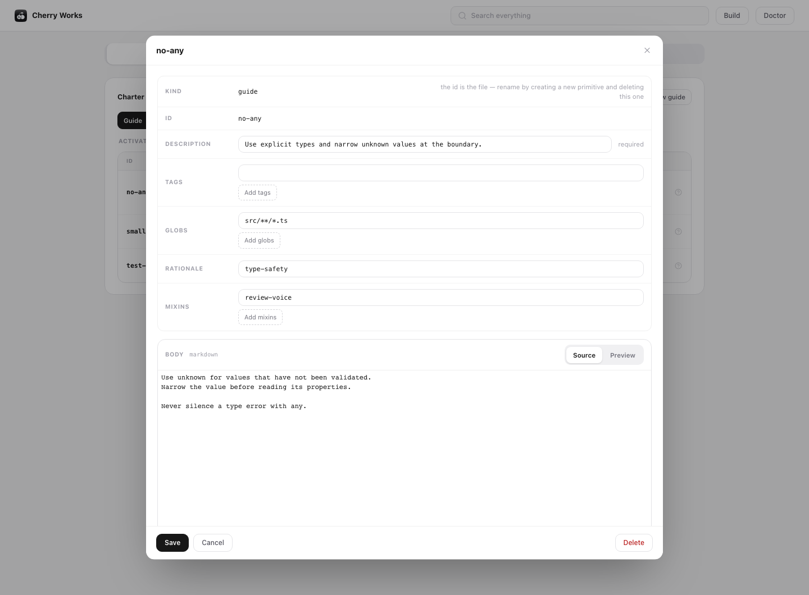
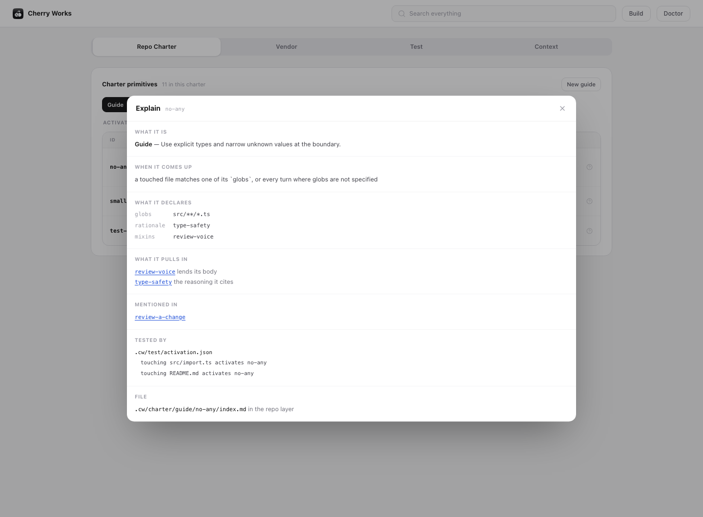
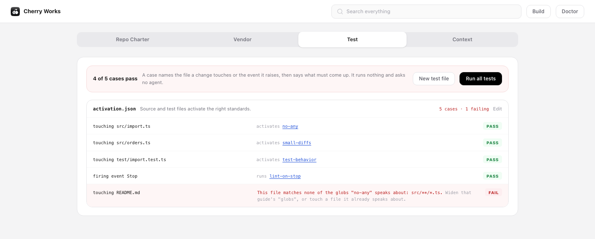

# Cherry Works

A charter engine for coding agents. You write your team's standards as small
markdown files, and `cw` checks them, tests them and compiles them into the
files your coding agent actually reads.

```text
.cw/charter/<kind>/<id>/index.md
              │
           cw build
              ├── .cw/out/…                       shared compiled charter
              ├── CLAUDE.md, .claude/…, .mcp.json  Claude Code
              └── AGENTS.md, .agents/…, .codex/…   Codex
```

## Why

A coding agent follows whatever instructions it can see. Those instructions
usually end up as one long prompt file that nobody reviews and that falls out of
date. Cherry Works handles them the way you handle code:

- **Small, typed files.** Each rule is a separate primitive of one kind, such as
  a guide, a sensor or a posture. Each kind says which fields it requires and
  when it comes up.
- **One build.** `cw build` regenerates every file the agent reads from the
  charter in one pass. Nothing is edited by hand, and a rule you delete
  disappears from the output.
- **Checked and tested.** `cw doctor` names each broken file and says how to fix
  it. `cw test` runs cases that pin down which rule must come up for which file
  or event. It runs no command and needs no agent, so the result is the same on
  every machine.
- **Shared without copying.** You can install another team's charter as a vendor
  source. It is pinned to a version and committed with your code, and it never
  silently overrides your own rules.

## Requirements

- Node.js 22 or later
- git
- A supported agent. Choose [Claude Code](https://claude.com/claude-code) or [Codex](https://learn.chatgpt.com/docs/agent-configuration/agents-md).
  `cw` always writes a neutral output under `.cw/out/` as well.

## Install

```bash
npm install -g cherry-works
cw --help
```

To run it once without installing anything, use `npx cherry-works <command>`.
To pin one version to a repository, so that its scripts and its CI run that
version whatever is installed globally, add it as a development dependency:

```bash
npm install -D cherry-works
npx cw --version
```

`cw --version` prints the version you are running. Upgrade with
`npm install -g cherry-works@latest`.

## Install from source

To run `cw` from a checkout of this repository, you also need pnpm 10 or later.
Build it and link it globally:

```bash
git clone https://github.com/tamnguyenvt/cherry-works.git
cd cherry-works
pnpm install
pnpm build
pnpm link --global
cw --help
```

The link points at your checkout. After you change the sources, run
`pnpm build` again. To remove the link, run `pnpm uninstall --global cherry-works`.

## Quick start

Inside the git repository you want to govern:

```bash
cw init                       # asks which agent to compile for (claude selected; codex available), scaffolds .cw/charter/ and builds
cw kinds guide                # what a guide requires
cw add guide no-any --header description="No any in TypeScript." --header globs="src/**/*.ts"
cw edit guide:no-any          # write the body in $VISUAL or $EDITOR
cw build                      # compile the charter for your agent
cw doctor                     # check that everything holds
```

Commit `.cw/` together with what `cw build` wrote. Your agent now reads the rule
in every session in this repository.

## Charter → agent outputs

Choose one with `cw init --agent claude` or `cw init --agent codex`. To build for
both, set `"agents": ["claude", "codex"]` in `.cw/settings.json`, then run `cw build`.
Every primitive also has a shared compiled document under `.cw/out/<kind>/<id>/`,
with its mixins and assets.

| Charter primitive | Claude Code | Codex |
|---|---|---|
| `guide`, no `globs` | `.claude/rules/<name>.md`, importing the compiled guide | Body embedded in root `AGENTS.md` |
| `guide`, with `globs` | `.claude/rules/<name>.md` with `paths` | Body embedded in directory `AGENTS.md` files; `src/**/*.ts` → `src/AGENTS.md`, with the file condition retained |
| `sensor` | `.claude/settings.json` hook → `cw sensor run <signal>` | `.codex/config.toml` hook → `cw sensor run <signal> --agent codex` |
| `skill` | `.claude/skills/<name>/SKILL.md`; invoke with `/<name>` | `.agents/skills/<name>/SKILL.md`; invoke with `$<name>` or choose through `/skills` |
| `playbook` | `.claude/skills/<name>/SKILL.md`, sequencing other skills | `.agents/skills/<name>/SKILL.md`, sequencing other skills |
| `agent` | `.claude/agents/<name>.md`, with `tools` and optional Claude model | `.codex/agents/<name>.toml`, with feature restrictions and optional Codex model; remaining tools inherit the parent scope |
| `posture`, file permissions | `permissions.allow` / `permissions.deny` in `.claude/settings.json` | Native `cw` permissions profile in `.codex/config.toml`: `read`, `write`, `deny` |
| `posture`, command permissions | `permissions.allow` / `permissions.deny` in `.claude/settings.json` | Literal `Bash(...:*)` prefixes → `.codex/rules/cw.rules`, with `allow` / `forbidden`; applies outside the sandbox |
| `corpus` | Shared compiled document, read when cited | Shared compiled document, read when cited |
| `mixin` | Body included in the primitives that use it | Body included in the primitives that use it |
| `mcp` | `.mcp.json` starts `cw mcp serve` | `.codex/config.toml` starts `cw mcp serve` |
| `script` | Compiled assets under `.cw/out/script/<id>/`, run by references or sensors | Same shared assets |
| `template` | Compiled document under `.cw/out/template/<id>/`, read when referenced | Same shared document |

`<name>` is the primitive id with `/` replaced by `-`. The entry sections in
`CLAUDE.md` and `AGENTS.md` point to `.cw/out/CHARTER.md` and their own
catalogues: `catalogue.json` holds primitives supporting every known provider,
while `catalogue.<provider>.json` holds only primitives restricted to that
provider. Each host reads both files; shared
entries are not duplicated in provider catalogues. Entries have no
`agent-provider` field.

| Skill / playbook header | Claude Code | Codex |
|---|---|---|
| `disable-user-invocation: true` | `user-invocable: false`; model invocation remains available | Kept in the catalogue and entry instructions, outside native skills; no documented native flag hides only explicit invocation |
| `disable-model-invocation: true` | `disable-model-invocation: true`; explicit invocation remains available | `agents/openai.yaml` → `policy.allow_implicit_invocation: false` |

The main host differences:

- **Guide scope:** Codex discovers nested `AGENTS.md` along root → cwd. Root
  instructions retain glob pointers; file-specific conditions remain in the
  embedded text. Builds preserve user sections and retire stamped generated
  sections. The generated config sets `project_doc_max_bytes` to 1 MiB;
  compilation does not read or size existing instruction files.
- **Permissions:** Codex's file profile extends `:workspace`. Bare file paths map
  to write grants or denies; `Read` maps to read, `Write`/`Edit` to write. Denying
  `Read` blocks both reads and writes; denying `Write`/`Edit` makes the path read-only.
  Legacy sandbox settings can override profiles. Unsupported mappings produce warnings.
- **Hooks and agents:** Sensors receive their host's event JSON; scripts that
  assume Claude payloads need adaptation. Unsupported Codex events produce build
  warnings; new hooks require trust through `/hooks`. Subagent feature flags
  restrict capability groups, not exact tool or MCP whitelists.

| Measurement / evaluation | Claude Code | Codex |
|---|---|---|
| `cw context` | Offline estimate | Offline estimate |
| `cw context --exact` | Supported | Not implemented |
| Session token logging and `cw eval` | Supported | Not implemented; Claude's built-in token counter is excluded from Codex hooks |

## The charter

A primitive is a markdown file with YAML front matter. The folder it sits in
names its kind:

```markdown
---
kind: guide
id: no-single-word-naming
description: How to name a function or a variable.
globs: ["src/**/*.ts"]
---

Never name a function or variable with a single vague word such as `it`, `data`
or `merged`. Name it after what it holds or does.
```

Only `posture` and `sensor` accept `agent-provider: [claude, codex]`. Omit it or use `[]`
to support all providers; list providers to install and activate the primitive
only for those hosts. For example, `agent-provider: [claude]` keeps a
Claude-specific sensor out of Codex hooks. Rebuild after changing the list.
Hooks pass `--agent claude` or `--agent codex`; manual `cw sensor run`
defaults to Claude for compatibility.

Each kind comes up at a different time:

| Kind | Comes up when |
|---|---|
| `guide` | a touched file matches one of its `globs`, or on every turn when it has no globs |
| `sensor` | the `signal` it names is raised, and the harness runs its `run` command |
| `skill` | one of its `triggers` matches the request, or it is invoked by name through the host |
| `playbook` | one of its `triggers` matches, or it is invoked by name; its body is a sequence of skills |
| `agent` | it is spawned by its id, with the host capability controls mapped above |
| `posture` | always, wherever the host can be told what to `allow` and `deny` |
| `corpus` | a primitive's `rationale` cites it, to give the reasoning behind a rule |
| `mixin` | never on its own; its body is lent to the primitives that pull it in |
| `mcp` | a primitive's body names it as `[[<id>]]`: an mcp origin outside the repository, reached through `cw mcp serve` |

A skill or a playbook that is only a step of another can say
`disable-user-invocation: true`: it is not offered for direct user invocation,
and the agent still opens it when its triggers match or a playbook sends it there.
One that only you should start can say `disable-model-invocation: true`.
The host-specific mappings and limits are listed above. A primitive
cannot say both, since then nobody could open it.

`cw kinds <kind>` gives the exact fields each kind takes. An id names exactly
one primitive across the whole charter, whatever its kind. If two files claim
the same id, the build is refused and both files are named. A primitive is
named by its id alone: bare in a header (`rationale: type-safety`), a test or a
command, and as `[[<id>]]` in a body, which the build turns into a link.
Every primitive is a folder holding its `index.md`, and any other file in that
folder is one of its assets, reached from the body as `./<file>`. An id is at
most 40 characters, and may be grouped with `/`: the mcp `mfbs/billing` is kept at
`.cw/charter/mcp/mfbs/billing/index.md`.

`cw build` compiles every primitive to `.cw/out/<kind>/<id>/index.md`, with its
assets copied beside it: its headers,
then the bodies of the mixins it pulls in, then its own. What your agent's host
is given points to that document, so you can open any primitive exactly as the
agent reads it.

## Commands

| Command | What it does |
|---|---|
| `cw init [--agent]` | Set the repository up under a charter, and build it |
| `cw build [--preview]` | Compile the charter, or show what a build would write |
| `cw list [--kind] [--min]` | List what the charter holds |
| `cw kinds [kind]` | List the kinds, or the fields one of them requires |
| `cw add <kind> <id> [--header k=v …]` | Write a new primitive |
| `cw edit <id>` | Open a primitive's file in your editor |
| `cw remove <id> [--yes]` | Delete a primitive this repository authored |
| `cw explain <id>` | Show which file declares an id, what it pulls in and which tests name it |
| `cw doctor` | Check the agents, the charter, the vendor sources and the compiled output |
| `cw context [--exact]` | Say how many tokens the charter puts into the agent's context when a session opens |
| `cw sessions [--since] [--until] [--json]` | Sum up the tokens of the sessions kept on this machine, by day and by session |
| `cw test` | Run every case in `.cw/test/` against the charter |
| `cw eval` | Put every case in `.cw/eval/` to the real agent under promptfoo |
| `cw suite add \| edit \| remove` | Manage test files |
| `cw vendor add <source> [--ref] [--skill] \| remove \| list` | Install, update, remove or list vendor sources: a charter, or skills from a repository listed on [skills.sh](https://skills.sh) |
| `cw portal [--port]` | Open the charter in a browser on this machine |
| `cw mcp auth [id] [--status]` | Sign in, as yourself, to every mcp origin the charter reaches, or to one again |
| `cw mcp serve` | Serve every mcp origin the charter reaches to your agent, over stdio |

`cw doctor` exits with a failure status when the charter has an error, when a
vendored file was edited in this repository, or when the compiled output no
longer matches the charter. That makes it a gate you can run in CI.

## The portal

If you would rather not remember commands and field names, run the portal from
inside a governed repository:

```bash
cw portal               # serves on port 9927, or the next free port
cw portal --port 8080
```

It prints an address such as `http://127.0.0.1:9927/?t=…`. Open that address in
your browser. The page has three tabs:


- **Repo Charter** lists every primitive of this repository by kind, with the
  engine's own line on when that kind comes up. From here you can create a
  primitive, then open it to edit its fields and its markdown body, or delete
  it. The form is built from what the kind requires, so it asks only for the
  fields that kind takes. The **?** on a row explains the primitive: when it
  comes up, what it pulls in, what cites it and which tests name it.

  | Editing a primitive | Explaining it |
  |---|---|
  |  |  |
- **Vendor** lists the vendor sources you installed and their primitives, which
  are read-only. You can add a source by its git address and a version, or
  remove one.
- **Test** lists the test files in `.cw/test/`. You can create, edit and delete
  them, and run every case to see which pass and why a failing one failed.

  

The header has a search that finds any primitive in any layer, and two buttons:
**Build**, which shows what a build would write before it writes anything, and
**Doctor**, which runs the health check and offers a build when the output is
behind.

The portal drives the same engine as the command line and adds no behaviour of
its own. What it shows is what the engine answered, and everything it does has
a command-line equivalent. When the engine refuses a change, the portal shows
the refusal in the engine's words and writes nothing. It listens only on
`127.0.0.1`, and every request needs the token in the printed address. Stop it
with Ctrl+C.

## Testing a charter

A test file in `.cw/test/` describes situations and what must come up in each
one:

```json
{
  "description": "The TypeScript guide comes up on source files.",
  "cases": [
    { "do": { "touchFile": "src/one.ts" }, "expect": { "activate": "no-any" } },
    { "when": "Stop", "expect": { "run": "lint" } },
    { "do": { "touchFile": ".env" }, "expect": { "allow": false } }
  ]
}
```

`cw test` resolves each case against the charter and reports the ones that no
longer hold. It runs no agent and costs nothing, so it fits in CI.

## Evaluating against the real agent

`cw test` proves what the charter says; `cw eval` proves what the agent does
with it. A file in `.cw/eval/` holds prompts and what is expected of each:

```json
{
  "description": "Planning goes through the planning skill.",
  "cases": [
    { "prompt": "plan this feature: export a report as PDF", "expect": { "invoke": "sdd-plan", "maxTokens": 200000 } },
    { "prompt": "add a function that totals an invoice", "expect": { "follow": "no-single-word-naming" } }
  ]
}
```

Each case expects at least one of:

| Expectation | Passes when |
|---|---|
| `invoke: <id>` | the agent invoked that skill or playbook |
| `follow: <id>` | a model judge finds the agent followed that guide |
| `maxTokens: <n>` | the case used no more than that many tokens |

```bash
cw eval
```

Every case is handed to [promptfoo](https://www.promptfoo.dev), which puts its
prompt to Claude Code run headless, in a worktree of your last commit with the
charter built, so your working tree is never touched. You never write a
promptfoo configuration. The first run installs promptfoo and the Claude Agent
SDK under `~/.cherry-works/promptfoo/`, and later runs reuse them.

The report gives each case's outcome and tokens, and the run's total. A case
that misses what it expects fails the run, with what the agent did instead.
It runs on whatever Claude Code is signed in with, or on `ANTHROPIC_API_KEY`
when set, and spends real tokens: commit before you run it, and keep the cases
few.

## What the charter costs

Everything the charter loads when a session opens — always-on guides, every
skill's description, every subagent's — is paid for on every turn.

```bash
cw context           # each primitive's tokens, the largest first, estimated
cw context --exact   # counted through the agent's own command line
```

A guide with `globs` is listed apart: it is loaded only when a file it names is
touched. `cw build` prints the total in one line, the portal shows the same
list, and `cw doctor` warns once the total passes `mainContextCeiling` in
`.cw/settings.json` (20,000 tokens unless you set it).

Once a session runs, the engine's own Stop hook counts what it has used, its
subagents included, each time the agent stops. It keeps one line per stop
under `~/.cherry-works/` (or the folder `sessionAnalysisFolder` names), never in
the repository, and tells you in one line each time a session crosses another
`sessionContextMark` tokens (100,000 unless you set it). The model is never
sent that line.

```bash
cw sessions                          # the last 31 days, by day and by session
cw sessions --since 2026-10-01       # 31 days from that day at most
cw sessions --since 2026-10-01 --until 2026-10-05 --json
```

To put a price on it, ask your agent what last week cost: the built-in
`cw-session-cost` skill reads the same summary, asks whether to use prices you
type or the provider's published ones, and answers per session and per day,
naming the prices it used.

Both limits are set in `.cw/settings.json`; leave one out to keep its default:

```json
{
  "agents": ["claude"],
  "mainContextCeiling": 20000,
  "sessionContextMark": 100000
}
```

- `mainContextCeiling` — the tokens a session may open with before `cw doctor`
  warns. Raise it when your charter is meant to be large.
- `sessionContextMark` — every how many tokens a running session tells you what
  it has used so far.

Each is a whole number above 0. Run `cw build` after changing either, then
`cw doctor` to check.

## Vendor sources

```bash
cw vendor add git@github.com:your-org/charter-baseline.git --ref v1.2.0
```

A vendor source is a git repository set up with `cw init`: author its charter
there, test it, and push. Only its `.cw/charter/` folder is installed, under
`.cw/vendor/<owner>/<repository>/`, pinned to the ref you chose, with the source's
`README.md` beside it, and left unstaged for you to read and commit, whatever
else you have in hand. A repository
without that folder is refused, and so is one that has vendors of its own:
vendoring is one level deep. Vendored primitives are read-only. To differ from
one, write your own primitive under a new id.

Run `cw vendor add` again with a new `--ref` to update a source, and
`cw vendor remove <owner>/<repository>` to take it away, the folder as
`cw vendor list` shows it. Run `cw build` after either. A source installed
before 0.8.0 sits in `.cw/vendor/<repository>/` and keeps working; remove it and
add it again to move it.

### Skills from `npx skills` repositories

`cw vendor add` also installs skills from a repository made for
[`npx skills`](https://github.com/vercel-labs/skills), one that holds no
charter but a `skills/` folder with a folder and its `SKILL.md` for each skill,
`skills/<name>/` or grouped up to three folders deep, as in
`skills/<group>/<name>/`:

```bash
cw vendor add https://github.com/mattpocock/skills --skill grill-me --skill grilling
cw vendor add https://github.com/mattpocock/skills   # every skill it holds
```

`--skill` names a skill by the `name` its `SKILL.md` declares, and can be
given more than once; with none, every skill is installed. Each lands in
`.cw/vendor/<owner>/<repository>/skill/<name>/` as a skill of your charter,
read-only like any vendored primitive, with every file beside its `SKILL.md`,
and left unstaged for you to read and commit:

| `SKILL.md` | Becomes |
| --- | --- |
| `name` | the skill's id, and its one trigger |
| `description` | its description |
| `disable-model-invocation: true` | `disable-model-invocation: true` |
| `user-invocable: false` | `disable-user-invocation: true` |
| any other header (`license`, `allowed-tools`, `argument-hint`…) | left out; `cw vendor add` names each one it left out |

Only `skills/` is looked in: a `SKILL.md` elsewhere, such as the copies a
repository keeps for its own agent under `.claude/skills/`, is not a skill to
install, nor is one below another skill's folder, which comes along as one of
its files. A `SKILL.md` without a
`name` or a `description`, with a name that is not an id, or with a name another
one shares, stops the install. A source holding a `.cw/charter/` folder is a
charter, installed whole: `--skill` is refused for it. A skill named by
another skill in prose, as `grill-me` names `grilling`, is not installed with
it: add it with a second `--skill`. Run `cw vendor add` again to update the
skills you name; the others in the folder stay as they were.

### Recommended charter vendors

| Charter | What it gives your agent | Install |
| --- | --- | --- |
| [sdd-charter](https://github.com/tamnguyenvt/sdd-charter) | Spec-driven development: a spec set with a status per story and a roadmap of their dependencies, and six commands (`/sdd-init`, `/sdd-plan`, `/sdd-implement`, `/sdd-bug-fix`, `/sdd-status`, `/sdd-report`) that take each story from request to merge, stopping for your yes at each step. | `cw vendor add git@github.com:tamnguyenvt/sdd-charter.git --ref v0.1.7` |
| [hexagonal-architecture-charter](https://github.com/tamnguyenvt/hexagonal-architecture-charter) | Sets up a hexagonal (ports and adapters) architecture in a folder you choose, then keeps the agent following it. | `cw vendor add git@github.com:tamnguyenvt/hexagonal-architecture-charter.git --ref v0.1.0` |

## MCP origins outside the repository

Much of what an agent needs to know is kept elsewhere: another service's code,
an issue tracker, a wiki. An `mcp` primitive declares one such mcp origin, an MCP
server, and the tools of it your agent may use:

```markdown
---
kind: mcp
id: mfbs/billing
description: Billing service code and pull requests.
endpoint: https://api.githubcopilot.com/mcp/
path: moneyforward/billing-service
auth: ["oauth", "token"]
tools: ["get_file_contents", "search_code", "list_pull_requests"]
---

The billing service. Look here before changing anything that charges a customer.
```

An mcp origin is either an `endpoint` reached over HTTP, or a `command` with its
`args` that `cw` starts as a local process; a local one takes a token only, in
the environment variable its `tokenEnv` names. Any primitive points the agent
at an mcp origin by naming it in its body as `[[mfbs/billing]]`.

```bash
cw mcp auth         # sign in to every mcp origin the charter declares that you are not signed in to yet
cw build            # asks each mcp origin for its tools; adds one entry, cw mcp serve, to your agent's .mcp.json
cw mcp auth --status
```

Sign in before you build: the build reaches each mcp origin under your
credential, and stops on one you are not signed in to. Every developer signs in
as themselves, by browser where the mcp origin offers OAuth or with a token
typed at a hidden prompt. GitHub's MCP server does not let `cw` register for
OAuth, so sign in there with a personal access token. Credentials are kept in the operating
system's credential store, never in the repository, and renewed without asking
where the mcp origin allows it. `cw mcp serve` is the one MCP server your agent is
given: it serves the tools each mcp origin declares and forwards every call under
your own credential. An mcp origin that is down or not signed in to loses only its own
tools.

The build asks each mcp origin for its tools once and keeps them beside the
charter, and turns your agent's own tool search on: a session opens with each
tool's name and no schema, and the agent looks up the one it needs. `cw mcp
serve` lists the kept tools without reaching any mcp origin, and reaches one
only for a call. A tool an `mcp` declares that its mcp origin does not list
stops the build.

A subagent reaches only the mcp origins it lists under `tools`: `[[<id>]]` for every
tool of an mcp origin, or `[[<id>]]:<tool>` for one of them.

## Your agent can write rules too

Every governed repository gets a built-in skill, `cw-author`, in the
agent's hands from the moment `cw init` finishes. It teaches
the agent to ask `cw kinds` what a kind requires and to write primitives with
`cw add`, instead of copying fields from memory.

## Development

```bash
pnpm install
pnpm exec playwright install chromium   # once per machine, for the portal's browser tests
pnpm test                               # dependency rules, build, then every test
pnpm typecheck
pnpm cw <command>                       # run the CLI from source, without building
```

A release is `pnpm release <version>`, run from a clean `develop` level with
`origin/develop`. It runs the tests, installs the exact package it would publish
into a fresh repository and builds it there, and only then commits, tags
`v<version>`, publishes and pushes. `pnpm release <version> --dry-run` runs
every check and changes nothing. A plain `npm publish` is refused.

The engine follows a hexagonal layout. `src/hexagon/` holds the domain, the
application use cases and their ports. `src/driver/` holds the CLI and the
portal that drive it. `src/zdriven/` holds the adapters for files, git and YAML.
What it must do is written in [specs/spec.md](specs/spec.md).

This repository is governed by its own charter under [.cw/charter/](.cw/charter/).
