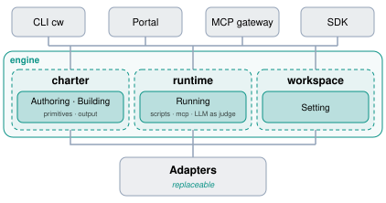

# Architecture notes

How the engine is written today, inside the lines [ADR.md](ADR.md) draws. A
note is rewritten whenever the code or the user's word changes it, and says
only what is true now; a decision that breaks the architecture's design is an
ADR instead, never rewritten.

## A primitive is named by its id alone

Story: [CORE Story 27](../specs/spec-core.md#core-story-27---name-every-primitive-by-its-id-alone-priority-p1), [CORE Story 40](../specs/spec-core.md#core-story-40---read-one-consistent-account-of-the-charters-behaviour-priority-p1)

An id is unique across the whole charter, whatever its kind; there is no
`kind:id`. A header (`rationale`, `mixins`), a test case and a command write
the bare id (`rationale: why-small`, `cw explain no-any`); a body, a sensor's
`run` and an agent's `tools` write `[[<id>]]`, which the build turns into a
link to that primitive's compiled file. Only text written that way is a
reference, so prose is never taken for one. A header value starting with
`[[` is quoted (`run: "[[check]]"`); a field that takes one kind reads an id
of another as missing.

A catalogue entry, in `catalogue.json`, holds the primitive's kind, its id, its description, the file its body is in, and the files it applies to where it names any. The id remains the only name the primitive has; the kind is a field of its entry.

## Git fetches sources and runs worktrees, nothing more

Story: [CORE Story 35](../specs/spec-core.md#core-story-35---set-a-repository-up-anywhere-with-or-without-git-priority-p2), [CORE Story 37](../specs/spec-core.md#core-story-37---pull-and-remove-a-charter-in-any-folder-priority-p3)

No use case asks for version control unless it cannot work without it:
pulling and forking a charter fetch its source, on a port named for
fetching sources, and an evaluation runs each case in a worktree of the last
commit. Setup and the portal ask nothing of git, and removing a charter
neither commits nor looks at work in hand. A repository without git has no
review, history or undo of its charter; the tool or the developer takes them
on.

## Nothing tells an edited installed charter

Story: [CORE Story 37](../specs/spec-core.md#core-story-37---pull-and-remove-a-charter-in-any-folder-priority-p3)

The engine never checks whether an installed charter's file was edited, by
git or by a record of its own: `cw doctor` has no line for installed charters,
`cw charter pull`, `cw charter update` and `cw charter remove` compare nothing,
and nothing but its `cw-package.json` is kept beside an installed charter.
`cw edit` and `cw remove` refuse an installed charter's primitive; an edit made
by hand is caught in the diff that brought it, and pulling the charter again
replaces it.

## Each thing in the specs has one term

Story: [CORE Story 53](../specs/spec-core.md#core-story-53---keep-the-whole-engine-to-its-naming-and-fault-guides-priority-p2) ([CORE-SC-069](../specs/spec-core.md#core-sc-069))

Every spec names each thing by one term, and no term names two things:

| Thing | Term | Never |
|---|---|---|
| The coding agent a charter is built for | agent | host, agent provider |
| A primitive of the `agent` kind | agent primitive, or subagent once built | agent, where the agent built for could be meant |
| The primitive a mixin is pulled into | the primitive that pulls it in | host |
| The part of an address before its path | host name | host |
| The set of adapters the engine is composed with | the engine's adapters | plugin, storage, composition |
| One of them | adapter | plugin |
| A program composing the engine through the package | integrator | tool author, tool |
| What an agent calls on an mcp origin | tool | — |
| `.cw/log/` | the log | — |
| The agents' sessions kept on a developer's machine | the sessions | log, session log |
| What a use case writes for whoever runs the system | diagnostics | logs |
| The engine's two parts | authoring and running | the charter's part |
| One primitive's file | a primitive's file | charter file |
| The whole | the charter root, or the charter where no one charter is named | — |
| One named set of primitives, in `.cw/charter/<charter>/` | a charter | group |
| The per-agent adapter laying the compiled output | projection | — |
| What a build compiles | the compiled output, a compiled file | projection, projected file, output folder, build's output |
| What compiles a charter and applies it | the engine | harness |
| `.cw/`: the charter, the compiled output and the log, the settings apart | the workspace | — |
| The store laying the compiled output and each agent's files onto a checkout | the local output | — |

A test or an eval case is kept beside the charter's primitives and is none of them.

ADR-001 was written before this glossary and is never rewritten: its
"workspace" is the module of the settings, and its "logs" are diagnostics.
The code keeps that module's name, `src/module/workspace/`: the module that
keeps the settings and sets a repository up, which the specs call setup and
the settings, never the workspace.

Every later story, FR and SC writes these terms, and `test/naming-each-thing-once-in-the-specs.test.ts` refuses the ones set aside. A user's words quoted under **Input** keep what they said, but for a term the test refuses.

## A source file is named `<kebab-subject>.<role>.ts`

Story: [CORE Story 42](../specs/spec-core.md#core-story-42---keep-the-engines-architecture-consistent-with-its-charter-priority-p2), [CORE Story 53](../specs/spec-core.md#core-story-53---keep-the-whole-engine-to-its-naming-and-fault-guides-priority-p2)

Every file under `src/`, the portal's page's among them, is named as NestJS names one:
the subject in kebab-case, then the role its folder gives it —
`build-charter.service.ts`, `authoring-charter.use-case.ts`,
`managing-charter.port.ts`, `file-charter.repository.ts`,
`in-memory-file-output.adapter.ts`, `adapter.fault.ts`, `add.command.ts`,
`charter-root.factory.ts`, `primitive-layer.value-object.ts`. A model under a
module's `domain/models/` keeps its subject alone (`charter-root.ts`), as do
the files an agent's adapters keep of their own, `helper.ts`, `index.ts`, a
module's `module.ts` and its `domain/constants.ts`, the kernel's
`domain/schema.ts`, the composition root's `composition.ts`, and the entry
files `main.ts` and the portal page's `main.tsx`; and what a generator wrote
and keeps writing, the portal page's shadcn components under `components/ui/`
and their `lib/utils.ts`, keeps the names it was given. A script asset is `<kebab-subject>.script.mjs`
(`session-tokens-counter.script.mjs`), and the build puts it down under the
name it declares. The class inside keeps its name.

## How a module is laid out

Story: [CORE Story 44](../specs/spec-core.md#core-story-44---keep-a-repositorys-state-in-a-store-of-ones-own-priority-p2), [CORE Story 45](../specs/spec-core.md#core-story-45---find-each-rule-of-the-engine-beside-the-value-it-is-about-priority-p2), [CORE Story 47](../specs/spec-core.md#core-story-47---keep-a-charter-in-any-layout-and-hand-it-over-by-layer-and-kind-priority-p2), [CORE Story 53](../specs/spec-core.md#core-story-53---keep-the-whole-engine-to-its-naming-and-fault-guides-priority-p2)

- **A use case** is the application service: a class in `app/`, extending
  `ApplicationService`, answering every operation through
  `answerWithFaultDTO`, which writes the diagnostics. What several use cases
  follow and no adapter keeps is a service in `app/services/`
  (`BuildCharterService`, `LoadMcpOriginsService`), a class whose one
  instance its file exports and the composition root hands in.
- **A repository is an adapter**: it answers a store's driven port in
  `infra/`, named for how and what it keeps (`FileCharterRepository`,
  `KeychainCredentialsRepository`), with an `InMemory*` twin for tests.
- **A domain service** is a class of static methods in `domain/services/`,
  `<Name>Service`, each named verb first for what it does over several
  models (`CharterOutputService.compileCharterRoot`, `TestSuiteService.runSuite`),
  holding no state, never constructed, answering with a model.
- **A factory** sits beside the models it makes, in their folder under
  `domain/models/` (`charter-output/charter-md.factory.ts`), a class
  `<Model>Factory` whose `create` makes one model out of what is handed in
  raw, every function it calls written in its class. An agent's own
  factories sit beside its projection, under `infra/<agent>/`.
- **Every value of the domain is a class**: a zod schema is a static member
  of its class, a constant a variable private to its file, read off a static
  member where another file needs it.

## A value object

Story: [CORE Story 45](../specs/spec-core.md#core-story-45---find-each-rule-of-the-engine-beside-the-value-it-is-about-priority-p2), [CORE Story 53](../specs/spec-core.md#core-story-53---keep-the-whole-engine-to-its-naming-and-fault-guides-priority-p2)

A value object is a value an entity or an aggregate holds as a property
(`McpCredential.method`, an `McpAuthMethod`), named
`<subject>.value-object.ts`, beside the models that hold it, in the
folder of its concept under `domain/models/`; a closed set of names is one, one instance
per name (`PrimitiveLayer.REPO`, `McpAuthMethod.OAUTH`). A value no model
holds is no value object: the folders and files each store of `cw`'s
keeps are that module's layout, one model made once in its `domain/constants.ts`
(`charterPath`, a `CharterPath`; `logPath`, a `LogPath`; `settingsPath`, a
`SettingsPath`), as the output's layout is `outputPath`, never a loose
constant. The
name (`LayerName`, `McpAuthMethodName`, `AgentProviderName`) stays only where
it crosses an edge — a stored file, a DTO, a driver port — and becomes the
value where it comes in.

## A use case's private method stands even where it is called once

Story: [CORE Story 53](../specs/spec-core.md#core-story-53---keep-the-whole-engine-to-its-naming-and-fault-guides-priority-p2) ([CORE-SC-067](../specs/spec-core.md#core-sc-067))

A use case keeps what only it follows in private methods, named verb first,
even where one is called once, so that it reads like the story it serves, a
step to a method. Where no-arbitrary-function-split would inline such a
method, hexagonal-naming wins. The naming review weighs a use case's private
methods by their names alone; no-arbitrary-function-split holds for
everything else.

## A fault is named for what is wrong

Story: [CORE Story 53](../specs/spec-core.md#core-story-53---keep-the-whole-engine-to-its-naming-and-fault-guides-priority-p2) ([CORE-SC-067](../specs/spec-core.md#core-sc-067), [CORE-SC-058](../specs/spec-core.md#core-sc-058))

Every fault is named `<What is wrong>Fault`, and a caller reads that name in
the `name` of its `FaultDTOs.Fault` (`UntestedPrimitiveFault`,
`InvalidSettingsFault`). Its message and its fix are what the person acts
on. Before 1.0.0 a fault is renamed freely; after it, a fault's name is part
of the contract.

## The compiled output is a list of its items

Story: [CORE Story 53](../specs/spec-core.md#core-story-53---keep-the-whole-engine-to-its-naming-and-fault-guides-priority-p2) ([CORE-FR-220](../specs/spec-core.md#core-fr-220))

What a build compiles is a `CharterOutput` holding a list of
`CharterOutputItem`s — the listing, `CHARTER.md`, each compiled primitive,
the mcp origins, the sensors — each known by its path inside the output and
made by its own factory, added in the order a build lays them. The output
adds an item by `add(charterOutputItem)`, the name the user gave: a list of
one kind adds by `add`, its argument naming what it adds, which
hexagonal-naming allows as its one bare verb. A projection finds the item it
needs by its class; an item the build did not add raises
`MissingCharterOutputItemFault`.

## An evaluation builds the charter as the store holds it now

Story: [CORE Story 53](../specs/spec-core.md#core-story-53---keep-the-whole-engine-to-its-naming-and-fault-guides-priority-p2) ([EVAL-FR-021](../specs/spec-eval.md#eval-fr-021))

An evaluation reads the charter and its cases as the store holds them now,
committed or not, builds them, and lays the compiled output into each case's
worktree of the last commit, where the agent runs, through the output's and
each projection's factory method for a checkout. The worktree is only a
clean place for the agent; the working tree is left as it was.

## The contract is one folder, a file per module

Story: [CORE Story 53](../specs/spec-core.md#core-story-53---keep-the-whole-engine-to-its-naming-and-fault-guides-priority-p2) ([SDK-FR-015](../specs/spec-sdk.md#sdk-fr-015))

The contract a release records is the folder `contract/`: a declarations
file per module of the engine, each declaration of the built library laid in
the file of the module that declares it, and the entry `index.d.ts` holding
what the library imports and every name it exports. A release compares the
build with the whole folder, declaration by name whichever file holds it,
and writes, commits and restores the folder; an older release's contract is
restored with `git checkout v<version> -- contract/`. A declaration moving
between modules is no change to the contract.
